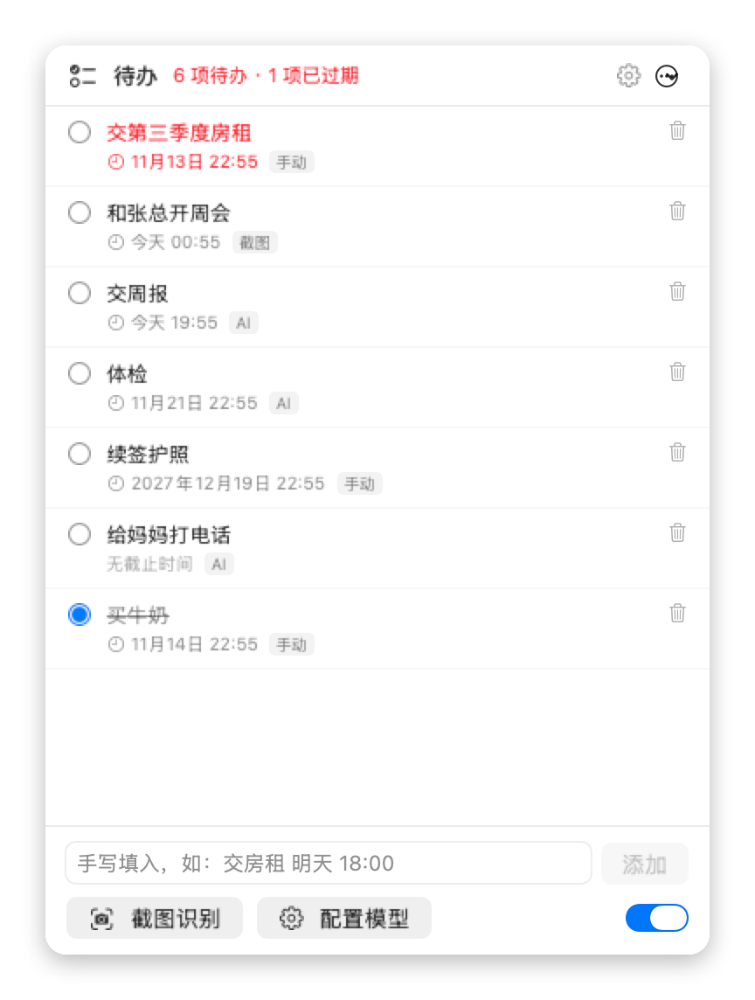

# Todolist.app

菜单栏常驻的原生 macOS 待办应用。事项以「截止时间 + 事项」呈现，支持手写填入、截图 OCR 提取、以及模型解析自然语言写入。



MIT License · 无第三方依赖 · 纯 Swift / AppKit + SwiftUI

## 安装

从 [Releases](https://github.com/Sad-Bee666/Todolist/releases) 下载 `Todolist-x.y.z.dmg`，打开后把 Todolist 拖进 Applications。

## 从源码构建

```bash
./build.sh     # 产出 dist/Todolist.app（含 ad-hoc 本地签名）
./install.sh   # 复制到 ~/Applications 并启动
./package.sh   # 产出 dist/Todolist-x.y.z.dmg
```

推送 `v*` 形式的 tag 会触发 GitHub Actions 自动构建并上传 DMG 到 Release。

- 需要 macOS 14+（本机 26.4，arm64）。
- 工具链只依赖 Xcode Command Line Tools。构建脚本显式传入 `-sdk` 与 `-module-cache-path`（沙箱环境下模块缓存必须落在项目内）。
- 应用是 `LSUIElement`（无 Dock 图标、无菜单栏主菜单），启动后只看右上角图标。

## 用法

| 操作 | 行为 |
| --- | --- |
| 鼠标移到菜单栏图标 | 自动展开面板（设置里可关） |
| 移开鼠标 | 未钉住时自动收起 |
| 点一下图标 | 钉住面板，方便输入 |
| 点面板外 / Esc | 收起 |
| 底部输入框回车 | 手写填入，**添加时自动解析**出事项与截止时间后写入（无需额外按钮） |
| ⌃⌥T | 框选屏幕区域 → 本机 Vision 取字 → 自动解析 → 写入 |
| 「⋯」 | 清除已完成 / 打开数据文件夹 / 退出 |

列表排序：未完成按截止时间升序，无截止时间的置底；已完成沉底。过期项整体标红。

时间呈现：**只有「今天」「明天」用相对说法，其余（含已过期）一律用日期**，例如 `11月21日 22:55`、`2027年12月19日 22:55`。

## AI 接口

OpenAI 兼容协议（`POST <Base URL>/chat/completions`），三档预设：

| 预设 | Base URL | 模型 |
| --- | --- | --- |
| DeepSeek（默认） | `https://api.deepseek.com/v1` | `deepseek-chat` |
| OpenAI | `https://api.openai.com/v1` | `gpt-4o-mini` |
| 自定义 | 自填 | 自填 |

- Key 优先存钥匙串（`com.sad-bee666.todolist` / `api-key-<provider>`），钥匙串不可写时退化为 `~/Library/Application Support/Todolist/secrets/` 下的 0600 文件。
- **没有 Key 也能用**：自动降级为本地规则解析器（`MockAIService`），识别中文数字（「十点」「一点半」）、时间段（「上午九点到十点」取开始时刻）、相对日期（「明天」「下周三」「6月1日」），并把时间词从标题里剥干净。面板右下角圆点显示当前引擎（绿=远端模型，橙=本地规则）。
- 提示词在 `Sources/AIPrompts.swift`，注入了当前日期时间、时区与星期，用于把相对时间换算成绝对时间；输出契约为严格 JSON。
- 手写填入与截图识别共用同一条抽取管线，提交即解析；解析不出结构时，截图文字会回填到输入框供你改。

## 权限

首次按 ⌃⌥T 时 macOS 会弹「屏幕录制」授权。请到 **系统设置 → 隐私与安全性 → 屏幕录制** 勾选 Todolist，然后退出并重开应用。全局快捷键用 Carbon `RegisterEventHotKey`，不需要辅助功能权限。

## 数据

`~/Library/Application Support/Todolist/todos.json`（原子写，损坏时自动另存 `.corrupt.json` 并重建）与同目录 `settings.json`。
调试可用环境变量 `TODOLIST_HOME` 覆盖数据目录。

## 代码结构

```
Sources/
  Models.swift            数据模型、AI 配置、AIServicing / OCRServicing 契约
  Store.swift             TodoStore / SettingsStore（JSON 持久化）
  Secrets.swift           API Key 存储（钥匙串 + 文件兜底）
  AppController.swift     装配、抽取管线、菜单栏与设置窗生命周期
  StatusItemController.swift  NSStatusItem + NSPopover + 悬停/钉住逻辑
  TodoPanelView.swift     下拉面板（SwiftUI）
  SettingsView.swift      设置窗（SwiftUI）
  OCRService.swift        screencapture + Vision
  HotKeyManager.swift     Carbon 全局快捷键
  AIClient.swift          OpenAI 兼容客户端 + 本地规则解析器
  AIPrompts.swift         提示词与 JSON 输出契约
  IMPort.swift            QQ / 微信预留接口（无实现）
  main.swift              入口
```

## 已验证

`docs/screenshots/` 下的截图是验收证据：

| 文件 | 内容 |
| --- | --- |
| `panel.png` | 面板全态（今天/明天 与日期形式混排、无截止时间置底、已完成沉底、过期标红） |
| `panel-empty.png` | 空列表态 |
| `settings.png` | 设置窗全貌 |

行为与链路验证：悬停开/合（真实光标移动，`[panel] open pinned=false` → `close`）、快捷键 `RegisterEventHotKey` 返回 true、本地假模型服务器上的真实 HTTP 往返（请求头/模型名/提示词注入日期均核对）、todos.json 落盘回读、错误分支（不可达地址 / 空 Key / 非 JSON），以及用真实系统截图跑通 `ScreenOCRService.recognizeText`。

未做端到端运行的部分：`screencapture -i` 的交互框选需要真人拖拽与首次「屏幕录制」授权。

## License

MIT，见 [LICENSE](LICENSE)。

## 预留的 IM 接入点

本版本**只留接口，不含收发功能**：

- `IMChannel`（`.qq` / `.wechat`）、`IMInboundMessage`、`IMOutboundMessage`
- `protocol IMBridge`：`channel` / `isRunning` / `onMessage` / `start()` / `stop()` / `send(_:)`
- `QQBridge`、`WeChatBridge`：占位实现，调用即抛 `.notConfigured`
- `IMBridgeRegistry`：通道注册表，`AppController.init` 已注册两个占位 bridge
- `protocol TodoIngest`：`AppController` 已实现，IM 文本可直接走与截图/粘贴完全相同的抽取管线

接入时只需实现 `IMBridge` 的三个方法，把 `onMessage` 接到 `(IMBridgeRegistry 持有者).ingest(text:source:)`。
